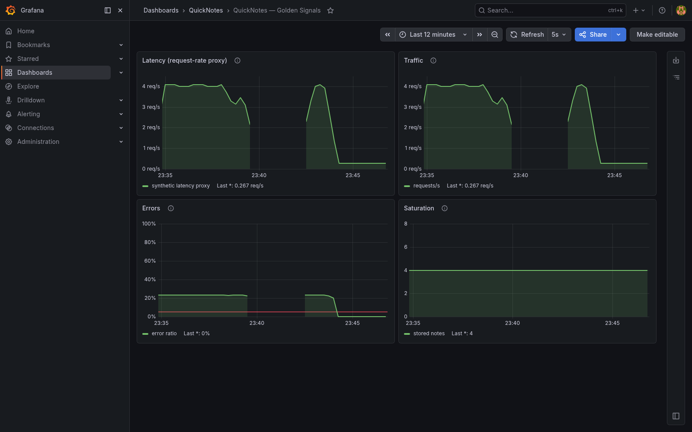
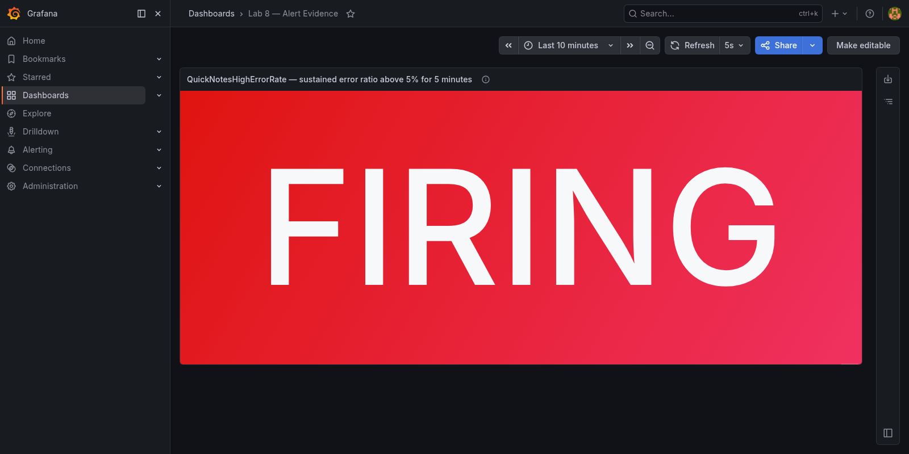

# Lab 8 — SRE & Monitoring: Golden Signals Dashboard + One Good Alert

## Environment

The lab was completed locally on macOS running on Apple Silicon. Docker Desktop runs Linux containers natively as ARM64.

```text
Docker client: 29.8.2 darwin/arm64
Docker server: 29.8.2 linux/arm64
Docker Compose: v5.6.0
QuickNotes image: quicknotes:lab6
Prometheus image: prom/prometheus:v3.11.2
Grafana image: grafana/grafana:13.0.1
```

The public `labs/lab8.md` and the local copy had the same SHA-256 hash before implementation:

```text
84740302c7682b3c89aae22f0aba197aa1473c2c3e1a11d2924522fe6c08cbfa
```

The mandatory 10-point portion was implemented. The Checkly bonus was not attempted because it requires a public tunnel and an external monitoring account.

---

# Task 1 — Prometheus, Grafana, and the Golden Signals Dashboard

## 1. Repository layout

The monitoring configuration is stored in the following paths:

```text
monitoring/
├── prometheus/
│   ├── prometheus.yml
│   └── alerts.yml
└── grafana/
    ├── dashboards/
    │   └── golden-signals.json
    └── provisioning/
        ├── dashboards/
        │   └── dashboard.yml
        └── datasources/
            └── datasource.yml
```

Required configuration files:

- [Prometheus scrape configuration](../monitoring/prometheus/prometheus.yml)
- [Grafana Prometheus data source](../monitoring/grafana/provisioning/datasources/datasource.yml)
- [Grafana dashboard provider](../monitoring/grafana/provisioning/dashboards/dashboard.yml)
- [Golden signals dashboard JSON](../monitoring/grafana/dashboards/golden-signals.json)
- [Prometheus alert rule](../monitoring/prometheus/alerts.yml)
- [Extended Compose stack](../compose.yaml)

## 2. Prometheus configuration

Prometheus scrapes exactly one application job every 15 seconds. The target is `quicknotes:8080`, where `quicknotes` is the Compose service name resolved by Docker DNS inside the shared Compose network.

```yaml
global:
  scrape_interval: 15s
  evaluation_interval: 15s

rule_files:
  - /etc/prometheus/alerts.yml

scrape_configs:
  - job_name: quicknotes
    static_configs:
      - targets:
          - quicknotes:8080
```

The configuration and rule file were validated with Prometheus's own `promtool`:

```bash
docker run --rm \
  -v "$PWD/monitoring/prometheus:/etc/prometheus:ro" \
  --entrypoint /bin/promtool \
  prom/prometheus:v3.11.2 \
  check config /etc/prometheus/prometheus.yml
```

Output:

```text
Checking /etc/prometheus/prometheus.yml
  SUCCESS: 1 rule files found
 SUCCESS: /etc/prometheus/prometheus.yml is valid prometheus config file syntax

Checking /etc/prometheus/alerts.yml
  SUCCESS: 1 rules found
```

## 3. Grafana provisioning

Grafana provisions the Prometheus data source with the stable UID `prometheus`, URL `http://prometheus:9090`, and `isDefault: true`. The dashboard provider loads JSON from `/var/lib/grafana/dashboards`, which is the same path used by the read-only Compose mount.

The Grafana API confirmed the provisioned data source:

```json
{"name":"Prometheus","type":"prometheus","url":"http://prometheus:9090","isDefault":true,"uid":"prometheus"}
```

The API also found the provisioned dashboard:

```json
{"title":"QuickNotes — Golden Signals","uid":"quicknotes-golden-signals","url":"/d/quicknotes-golden-signals/quicknotes-e28094-golden-signals","folderTitle":"QuickNotes"}
```

The dashboard JSON was checked before startup:

```bash
python3 -m json.tool \
  monitoring/grafana/dashboards/golden-signals.json \
  >/dev/null
```

## 4. Four golden-signal panels

The provisioned dashboard contains exactly four panels:

| Golden signal | Panel query | Interpretation |
|---|---|---|
| Latency | `sum(rate(quicknotes_http_requests_total{job="quicknotes"}[1m]))` | The application has no duration histogram. The lab specification permits request rate as a synthetic proxy, and the panel explicitly warns that it is not real latency. |
| Traffic | `sum(rate(quicknotes_http_requests_total{job="quicknotes"}[1m]))` | Requests per second over a one-minute range. |
| Errors | `100 * sum(rate(quicknotes_http_responses_by_code_total{job="quicknotes",code=~"4..|5.."}[1m])) / clamp_min(sum(rate(quicknotes_http_requests_total{job="quicknotes"}[1m])), 0.001)` | Percentage of responses that are 4xx or 5xx. `clamp_min` prevents division by zero during an idle period. |
| Saturation | `quicknotes_notes_total{job="quicknotes"}` | Current number of stored notes, the available application-level gauge. |

Dashboard after mixed traffic:



The visual check showed non-trivial values on all four panels. During the deliberate error load, the dashboard reported approximately:

```text
Latency proxy: 4 req/s
Traffic:       4 req/s
Errors:        23.2%
Saturation:    4 notes
```

## 5. Compose stack and credentials

The existing Lab 6 `quicknotes` service remains unchanged. The Compose file adds pinned Prometheus and Grafana services. Prometheus waits for the real QuickNotes healthcheck before starting; Grafana depends on Prometheus.

Grafana credentials are not committed. Compose requires these two values from a local `.env` file:

```dotenv
GRAFANA_ADMIN_USER=<local-admin-name>
GRAFANA_ADMIN_PASSWORD=<unique-local-password>
```

The real local `.env` is excluded through `.git/info/exclude`, so it cannot accidentally enter the commit. No default Grafana credentials are present in a tracked file.

The complete Compose model passed validation:

```bash
docker compose config --quiet
```

The stack was started with:

```bash
docker compose up --build -d
```

Container state after startup:

```text
NAME                        IMAGE                     SERVICE      STATUS
devops-intro-grafana-1      grafana/grafana:13.0.1    grafana      Up
devops-intro-prometheus-1   prom/prometheus:v3.11.2   prometheus   Up
devops-intro-quicknotes-1   quicknotes:lab6           quicknotes   Up (healthy)
```

## 6. Traffic generation and scrape verification

The initial dashboard traffic contained 200 mixed requests:

```bash
for i in $(seq 1 140); do
  curl -fsS http://localhost:8080/notes >/dev/null
done

for i in $(seq 1 40); do
  curl -fsS http://localhost:8080/health >/dev/null
done

for i in $(seq 1 20); do
  curl -sS -o /dev/null \
    -X POST \
    -H 'Content-Type: application/json' \
    -d '{bad json' \
    http://localhost:8080/notes
done
```

QuickNotes health response:

```json
{"notes":4,"status":"ok"}
```

Required target check:

```bash
curl -s http://localhost:9090/api/v1/targets \
  | jq '.data.activeTargets[].health'
```

Output:

```text
"up"
```

The full target evidence was:

```json
[{"job":"quicknotes","health":"up","scrapeUrl":"http://quicknotes:8080/metrics","lastError":""}]
```

The direct PromQL check returned:

```text
up{job="quicknotes"} = 1
```

## 7. Design questions a–d

### a) Pull versus push

Prometheus initiates the connection and pulls `/metrics` from QuickNotes. Therefore QuickNotes must be reachable **from Prometheus** on the Compose network; QuickNotes does not need to initiate a connection to Prometheus. Docker DNS resolves the service name `quicknotes`, and port `8080` is the application's internal container port.

If Prometheus cannot reach QuickNotes, the scrape fails and `up{job="quicknotes"}` becomes `0`. Existing time series remain queryable until they become stale, but no fresh application samples arrive. This distinction matters: a target-down signal is a monitoring observation about reachability, not proof that every external user path is down.

### b) Effects of changing `scrape_interval: 15s`

At `5s`, Prometheus stores roughly three times as many samples as at `15s`. Queries scan more data, storage and CPU use rise, and short-window graphs become noisier. A high scrape frequency may also impose needless load on the application and can make `irate()`-style views overreact to one unusual sample.

At `5m`, short incidents can begin and end between scrapes and never appear. A query such as `rate(metric[1m])` cannot work reliably because its one-minute range normally contains fewer than the two samples required to calculate a rate. Dashboards update slowly, target failures are detected late, and a five-minute alert evaluation becomes coarse and delayed. The range used by `rate()` should include several samples; with a 15-second scrape, a one-minute range normally contains about four or five.

### c) `rate()` versus `irate()` versus `delta()`

`rate()` is correct for the Traffic panel because `quicknotes_http_requests_total` is a monotonically increasing counter. `rate()` uses all samples in the range, handles counter resets, and produces a smoothed per-second average appropriate for a dashboard.

`irate()` uses only the last two samples. It is useful for a very volatile, near-real-time view but is too noisy for the main traffic panel and for alerting. `delta()` returns the absolute change over a range and is intended for gauges; it does not provide a per-second counter rate and does not have the same counter-reset semantics.

### d) Why provision Grafana from files?

Provisioned files make the dashboard and data source reproducible, reviewable, and version controlled. A fresh `docker compose up` reconstructs the same monitoring UI without undocumented clicking. Changes can be reviewed in a pull request, tested, rolled back, and reused in CI or another environment. Manual UI configuration lives only in one Grafana database and is easy to lose when the container is recreated.

---

# Task 2 — One Good Alert and Runbook

## 8. Alert rule

The alert is defined in [monitoring/prometheus/alerts.yml](../monitoring/prometheus/alerts.yml):

```yaml
groups:
  - name: quicknotes-alerts
    interval: 15s
    rules:
      - alert: QuickNotesHighErrorRate
        expr: |
          sum(rate(quicknotes_http_responses_by_code_total{job="quicknotes",code=~"4..|5.."}[1m]))
          /
          clamp_min(sum(rate(quicknotes_http_requests_total{job="quicknotes"}[1m])), 0.001)
          > 0.05
        for: 5m
        labels:
          severity: page
        annotations:
          summary: QuickNotes error ratio is above 5%
          description: More than 5% of QuickNotes requests have returned 4xx or 5xx responses for five minutes.
          runbook_url: docs/runbook/high-error-rate.md
```

Important alert properties verified through the Prometheus API:

```json
{
  "name":"QuickNotesHighErrorRate",
  "health":"ok",
  "duration":300,
  "labels":{"severity":"page"},
  "annotations":{"runbook_url":"docs/runbook/high-error-rate.md"}
}
```

`duration: 300` is Prometheus's API representation of `for: 5m`.

## 9. Deliberate trigger

The alert was triggered with one malformed POST and three healthy requests per batch. The test used an absolute 450-second deadline so that command overhead could not shorten the required continuous interval. This creates a stable error ratio well above 5% without stopping the service:

```bash
end=$(( $(date +%s) + 450 ))

while [ "$(date +%s)" -lt "$end" ]; do
  curl -sS -o /dev/null \
    -X POST \
    -H 'Content-Type: application/json' \
    -d '{malformed' \
    http://localhost:8080/notes

  curl -fsS -o /dev/null http://localhost:8080/health
  curl -fsS -o /dev/null http://localhost:8080/notes
  curl -fsS -o /dev/null http://localhost:8080/health
  sleep 1
done
```

The measured ratio reached approximately 23.37%, then the rule stayed above the 5% threshold for the full five-minute gate. The observed state sequence was:

```text
inactive → pending → firing
```

Prometheus returned this real firing evidence:

```json
{
  "labels": {
    "alertname": "QuickNotesHighErrorRate",
    "severity": "page"
  },
  "annotations": {
    "description": "More than 5% of QuickNotes requests have returned 4xx or 5xx responses for five minutes.",
    "runbook_url": "docs/runbook/high-error-rate.md",
    "summary": "QuickNotes error ratio is above 5%"
  },
  "state": "firing",
  "activeAt": "2026-10-25T20:47:41.291370819Z",
  "value": "2.3369565217391305e-01"
}
```

The state was polled independently of the traffic process. `activeAt` remained unchanged throughout the pending period, and `Firing` was observed at `2026-10-25T20:52:57Z`, more than five minutes later.

Prometheus alert in `Firing` state:



## 10. Runbook

The standalone runbook is stored at [docs/runbook/high-error-rate.md](../docs/runbook/high-error-rate.md). Its complete operational content is reproduced below.

### What this alert means

More than 5% of QuickNotes HTTP requests have returned a 4xx or 5xx response continuously for at least five minutes, so users are likely failing to read or modify notes.

### Triage steps

1. Open `http://localhost:9090/alerts`, confirm that `QuickNotesHighErrorRate` is `Firing`, and compare the Grafana **Errors** and **Traffic** panels so that a high percentage based on tiny traffic is not misread.
2. Run `sum by (code) (rate(quicknotes_http_responses_by_code_total{job="quicknotes"}[5m]))` in Prometheus. Dominant `400` or `404` responses suggest a client/input problem; dominant `500` responses indicate a server-side failure.
3. Run `docker compose ps`, check `curl -fsS http://localhost:8080/health`, and confirm the Prometheus target is `UP`. If not, inspect `docker compose logs --since=10m quicknotes prometheus` before restarting anything.
4. Correlate the first error with application logs and recent image/configuration changes. Reproduce one failing request with `curl -v` and record its status and response body without secrets.
5. Inspect the **Saturation** panel and `/health` note count. For write failures, inspect persistence errors and verify the `quicknotes-data` volume mount.

### Mitigations

- Stop or rate-limit a misbehaving client or load generator that is producing malformed requests.
- If errors began after a deployment or configuration change, roll back to the last known-good image/configuration and recreate only QuickNotes with `docker compose up -d quicknotes`.
- If the process alone is unhealthy, use `docker compose restart quicknotes`, then verify `/health`, the Prometheus target, and the error ratio. Never use `docker compose down -v` during mitigation because it deletes the notes volume.

### Post-incident

Preserve the timeline, queries, relevant logs, triggering request, and mitigation result. Write a blameless postmortem using [Lecture 1 — Blameless Postmortems](../lectures/lec1.md#-slide-20--blameless-postmortems), assign corrective actions to owners with dates, and update the runbook where triage was unclear.

## 11. Design questions e–g

### e) Why require five sustained minutes?

One bad request can be a typo, a stale client, or a harmless probe and does not justify waking an on-call engineer. The five-minute `for` clause filters brief bursts and requires persistent user-visible symptoms before paging. It reduces flapping while still reacting quickly enough to an ongoing incident. A single burst can make the expression true temporarily and move the alert to `Pending`, but it returns to `Normal` before `Firing` if the ratio recovers.

### f) Symptom alert versus cause alert

A possible cause alert would be “page when QuickNotes container CPU exceeds 90%” or “page whenever the process restarts.” Either may correlate with a problem, but neither proves user impact: CPU can be high while requests succeed, and an intentional restart can be harmless. Conversely, users can receive errors while CPU is low. The error-ratio alert is better because it observes the failed user interaction directly; cause metrics remain useful for diagnosis or lower-priority warnings.

### g) Quantitative alert-fatigue threshold

If more than 10% of pages occur when there is no measurable user impact, the page is too noisy and must be tuned. “No measurable impact” means the error SLI and availability checks stayed within their objectives and no user-facing failure was confirmed during the page window. The team should review this monthly as `false or non-actionable pages / all pages`; for example, 3 non-actionable pages out of 20 is 15% and fails the threshold. Every page should also require a concrete human action; otherwise it should become a dashboard signal or ticket rather than a page.

---

# Final verification checklist

- Prometheus config and rule syntax: passed
- Grafana dashboard JSON syntax: passed
- Compose model validation: passed
- QuickNotes container healthcheck: healthy
- Prometheus target health: `up`
- `up{job="quicknotes"}`: `1`
- Grafana data source provisioning: passed
- Grafana dashboard provisioning: passed
- Four dashboard panels with real data: passed
- Error-ratio alert entered `Firing`: passed
- Runbook with meaning, ordered triage, mitigations, and post-incident steps: complete
- Git commit: not performed
- Git push: not performed
